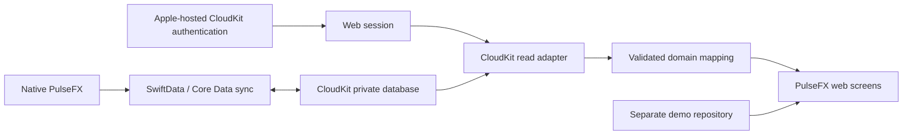

# PulseFX Web — integratieplan voor SwiftData / CloudKit

Onderzocht op 23 oktober 2026. Status: onderzoeks- en implementatievoorstel, geen gerealiseerde koppeling.

> **Actualisatie 25 oktober 2026:** dit document bewaart het oorspronkelijke onderzoek van 23 oktober. Sindsdien zijn het Production-schema en de velden van `CD_Account`, `CD_Trade` en `CD_OpenTrade` in de console gecontroleerd. De eerdere schemafout blokkeert de waargenomen native synchronisatie niet meer; de gebruiker heeft ontvangst in beide richtingen bevestigd. Browsertoegang via CloudKit JS is nog niet bewezen. De actuele veldmapping, beperkingen en testaanpak staan in het [ontwerp van de lokale leesproef](</Users/kunoboers/Desktop/PulseOS/3. Appstore Connect bestanden/PulseFX/PulseFX-Web-Read-Probe-2026-10-25.md>). Uitspraken hieronder over nog niet geïnspecteerde schema's of databases beschrijven de stand van 23 oktober. Er is geen live webkoppeling gebouwd.

## Advies en beslispunt

Start met een **uitsluitend lezende CloudKit JS-proef** op de private database van `iCloud.PulseOS.FX`, in development en met afzonderlijke testaccounts. Laat die proef bewijzen dat de door SwiftData gesynchroniseerde gegevens correct kunnen worden gelezen. Behoud SwiftData als eigenaar van het bestaande model. Na geslaagde validatie kan een eerste webversie accounts en handelsgeschiedenis tonen, met handmatig vernieuwen en zonder wijzigen, verwijderen of orders uitvoeren.

Dit is een onderbouwde route, nog geen bewezen compatibiliteit met de productiegegevens van PulseFX. Apple beschrijft dat SwiftData voor synchronisatie `NSPersistentCloudKitContainer` gebruikt; Apple documenteert ook webtoegang tot de daarmee gemaakte records. De feitelijke CloudKit-schema's, zones en webtoegang van deze app zijn nog niet geïnspecteerd. [SwiftData-synchronisatie](https://developer.apple.com/documentation/swiftdata/syncing-model-data-across-a-persons-devices), [Core Data-records lezen](https://developer.apple.com/documentation/coredata/reading-cloudkit-records-for-core-data).

**Belangrijke grens:** een lezende adapter is een beperking van onze code. Daarmee is een gebruikerssessie niet automatisch een door Apple afgedwongen read-only credential. Allowed Origins is evenmin een read-only machtiging. Voor productie moet expliciet worden besloten of directe browsertoegang met deze grens aanvaardbaar is, of een eigen serverlaag nodig is die uitsluitend leesoperaties aanbiedt en gebruikerstokens buiten de applicatie-JavaScript houdt. Ook die server heeft geldige CloudKit-gebruikersauthenticatie nodig.

## Wat is onderzocht

- Alleen Swift-bronnen, entitlements en projectconfiguratie van de bestaande native app gelezen. Geen native builds, projectwijzigingen of lokale gebruikersdatabases geopend.
- De huidige webdemo en haar repository-contract geïnspecteerd.
- Officiële Apple-documentatie geraadpleegd; oudere Web Services-documentatie als protocolreferentie gebruikt, niet als bewijs van actuele console-instellingen of gegarandeerde tokenlevensduur.
- Geen CloudKit Console-sessie geopend, geen gebruikerslogin uitgevoerd, geen API-token aangemaakt, geen records gelezen uit iCloud en geen schema of data gewijzigd.
- De lokale projectconfiguratie noemt versie `2.0.2`. Dit bewijst niet dat die exacte bronversie al is uitgebracht.

## Bevindingen uit de native app

| Onderdeel | Vastgesteld in broncode | Gevolg voor het web |
| --- | --- | --- |
| Container | iOS- en macOS-entitlements noemen `iCloud.PulseOS.FX`. [N1, N2] | Deze container onderzoeken; `iCloud.PulseOS.Lifts` hoort niet bij deze koppeling. |
| Opslag | Beide appstarts proberen `cloudKitDatabase: .automatic`, daarna `.none`, daarna een persistente herstelstore. [N3, N4] | Een gebruiker kan gegevens hebben die uitsluitend lokaal bestaan. Een lege cloud is geen bewijs van dataverlies of een leeg native account. |
| Syncstatus | `CloudStorageStatus` meldt beschikbaarheid en opslagmodus, geen bewezen import/exportvoortgang. [N5] | Toon in het web `Last fetched from iCloud`, niet `All devices synced`. De native lokale status is niet automatisch leesbaar via CloudKit. |
| Account | UUID, naam, `balance`, `startBalance`, `currencyRaw`, type, favoriet, archivering en doelen. [N6] | Gebruik het opgeslagen saldo en de eigen valuta. De demoregel startsaldo + voorbeeldtrades is niet geschikt voor echte accounts. |
| Journal | `OpenTrade` bevat zowel open als gesloten trades; status, resultaat, richting, account-UUID, datums, P&L, pre- en postnotities. [N7] | Niet alle `OpenTrade`-records zijn open. `statusRaw` en `resultRaw` afzonderlijk interpreteren. |
| Historische trades | `Trade` is een apart model, gekoppeld via `Trade.account`, met uitkomsten `open/tp/sl/be`. [N6] | Beide bronnen behouden met type-identiteit. Niet op instrument/datum dedupliceren en geen richting verzinnen voor oude trades. |
| Notities | `TradeNote` is weer een ander model: losse/gekoppelde notities, platte `body`, optionele RTF-data, foto's en UUID-verwijzingen. [N8] | Een webveld `note` mag niet stilzwijgend drie verschillende native notitievelden vervangen. |
| Media | `TradeScreenshot` heeft externe binaire data en optionele PencilKit-annotaties. [N9] | Screenshots, RTF en annotaties uitstellen; native binaire formats zijn geen direct bruikbare browserinhoud. |
| Kapitaal | `CapitalMovement` bewaart stortingen/opnames, kosten, valuta en saldo-effect. [N6] | Saldo is niet hetzelfde als gerealiseerde P&L. Geen historische balansgrafiek fabriceren uit alleen trades. |
| Mutaties | `saveClosedTrade` wijzigt trade én accountbalans en draait wijzigingen terug bij een savefout. [N10] | Losse recordwrites vanuit de browser zouden bestaande bedrijfsregels kunnen omzeilen. |
| Verwijderen | Accountverwijdering ondersteunt geschiedenis behouden of verwijderen; losse UUID-koppelingen worden expliciet bijgewerkt. [N11] | Ontbrekende accountkoppeling kan legitiem zijn. Verwijderde accounts en trades zorgvuldig onderscheiden. |
| Statistieken | Er zijn normalisatie-, filter- en rekenfuncties voor legacy en moderne trades, inclusief P&L per valuta en break-even in de winrate-noemer. [N12, N13] | Leg dezelfde definities vast in webfixtures; USD-demoformules niet overnemen. |
| Instellingen | `AppSettings` gebruikt App Group `UserDefaults` en selectief `NSUbiquitousKeyValueStore`. [N14] | Niet alle instellingen zijn CloudKit-records. Laat webvoorkeuren voorlopig expliciet apart. |
| Pro | `PurchaseManager` controleert geverifieerde StoreKit `Transaction.currentEntitlements`. [N15] | CloudKit-login bewijst geen aankoop, abonnement of Pro-toegang. Hiervoor is een aparte product- en verificatiekeuze nodig. |

De iCloud key-value store is een aparte Apple-opslaginterface. De onderzochte code geeft geen grond om die voorkeuren via de CloudKit-recordadapter te verwachten. [Apple: NSUbiquitousKeyValueStore](https://developer.apple.com/documentation/foundation/nsubiquitouskeyvaluestore).

## Beoogde architectuur

De pijlen naar de webadapter zijn alleen lezen. De demo blijft een afzonderlijke modus; een cloudfout mag nooit ongemerkt voorbeeldsaldi tonen als echte data.

| Route | Afweging | Voorstel |
| --- | --- | --- |
| CloudKit JS rechtstreeks vanuit de browser | Past bij de statische site; geen tweede database of backend met handelsdata. Browsercode beschikt wel over de gebruikerssessie. | Eerste proef en kandidaat voor read-only web, na de beveiligingsbeslissing. |
| Eigen serverlaag als leesproxy | Kan een lees-allowlist afdwingen en sessietokens afschermen voor applicatie-JavaScript. Introduceert tokenbeheer, sessiebeveiliging en backendverwerking van privédata. | Alleen kiezen als de sterkere operationele grens nodig is; vereist afzonderlijk ontwerp en validatie van de Apple-authflow. |
| Native app publiceert een apart, versiegebonden leesmodel | Minder afhankelijkheid van SwiftData-serialisatie. Vereist een native release, dubbele opslag, verwijderpropagatie en omgaan met vertraging. | Terugvaloptie als directe mapping onbetrouwbaar blijkt; niet vooraf bouwen. |

Apple biedt CloudKit JS voor publieke én private databases. Server-to-server authenticatie is geen alternatief om willekeurige private gebruikersdata te openen: Apple's server-key-route is voor de publieke database. [CloudKit JS](https://developer.apple.com/documentation/cloudkitjs), [Web Services-authenticatie](https://developer.apple.com/library/archive/documentation/DataManagement/Conceptual/CloudKitWebServicesReference/SettingUpWebServices.html).

## Concrete mapping: eerst verifiëren, daarna vastleggen

Onderstaande record- en veldnamen zijn **verwacht op basis van Apple's mapping**, niet bevestigd in PulseFX CloudKit Console. Core Data gebruikt `CD_`-namen; relaties verwijzen naar recordnamen, niet noodzakelijk naar de eigen model-UUID. Strings kunnen bovendien in een aanvullend assetveld staan. Daarom bewaren we recordidentiteit en domeinidentiteit afzonderlijk. [Apple: recordmapping](https://developer.apple.com/documentation/coredata/reading-cloudkit-records-for-core-data).

| Verwachte bron | Naar webmodel | Regel |
| --- | --- | --- |
| `CD_Account`: `CD_id`, `CD_name`, `CD_balance`, `CD_startBalance`, `CD_currencyRaw`, `CD_kindRaw`, `CD_isArchived` | `AccountSummary` | Balans uit het opgeslagen veld. Archief apart. Onbekende valuta/type tonen als onbekend; geen USD-default voor onleesbare echte data. |
| `CD_OpenTrade`: `CD_id`, `CD_symbol`, `CD_linkedAccountId`, `CD_statusRaw`, `CD_resultRaw`, `CD_directionRaw`, `CD_lotSize`, `CD_profitLoss`, datums | `JournalEntry`, bron `modern` | Account koppelen op model-UUID; long/short naar Buy/Sell; ontbrekende richting blijft onbekend. Open P&L niet als live koersresultaat presenteren. |
| `CD_Trade`: `CD_id`, `CD_pair`, `CD_account`, `CD_outcomeRaw`, `CD_profitLoss`, `CD_lotSize`, datums | `JournalEntry`, bron `legacy` | `CD_account` via het recordnamenregister naar een account oplossen; uitkomst normaliseren. Een onopgeloste relatie niet op naam raden. |
| Pre-/postnotities in `OpenTrade` | Aparte velden in het tradedetail | Beide expliciet behouden, alleen lezen. Lange tekst/asset-fallback eerst met fixtures bewijzen. |
| `CD_TradeNote` | Later apart `Note`-model | `body`, `richBodyData` en tradejournalnotities niet samenvoegen. Geen automatische RTF→HTML-injectie. |
| `CD_CapitalMovement` | `CapitalEvent` voor reconciliatie / latere historie | Geen dubbele toepassing op `Account.balance`; dat veld bevat al saldo-effecten. |
| `CD_TradeScreenshot` / `CD_NotePhoto` | Later media-adapter | Pas na aparte authenticatie-, asset-, grootte- en rendercontroles. |

UUID-koppelingen van `OpenTrade` en `CapitalMovement` zijn domeinvelden. De SwiftData-relatie van `Trade` is een ander mechanisme. Eén generieke join op een vermeende `id` is daarom onvoldoende.

Het eerste domeincontract bevat minimaal:

- `source`: `demo` of `cloudkit`; daarnaast `access: readOnly` en expliciete capabilities.
- `identity`: container, omgeving, database, zone-eigenaar/zone, recordnaam en recordtype; model-UUID apart.
- `accounts`: opgeslagen saldo, startsaldo, valutacode, type, archiefstatus.
- `trades`: bronmodel, domein-ID, account-ID of null, status én resultaat, nullable richting/P&L, openings- en sluitingsdatum.
- `snapshot`: `fetchedAt`, volledigheid, waarschuwingen en fetchstatus; geen claim van een atomische momentopname van alle native apparaten.
- `capabilities`: lezen toegestaan, cloudnotities opslaan uitgeschakeld, demo reset alleen in demo. Pro-status blijft `unverified` totdat daarvoor een apart besluit bestaat.

Voorgestelde toekomstige modules: `cloudkit-session.mjs`, `cloudkit-read-repository.mjs`, `cloudkit-mapping.mjs`, `domain-metrics.mjs`. Deze worden in dit onderzoek niet aangemaakt. De huidige `load/saveNote/reset`-interface moet eerst worden gesplitst in lezen en expliciete mutatie-capabilities; de demo behoudt haar eigen schrijfacties.

## Authenticatie en gegevensgrenzen

1. **Configuratie per omgeving.** Container en environment komen uit vaste build/deploymentconfiguratie, nooit uit een vrij wijzigbare queryparameter. Development- en productiontokens en toegestane origins gescheiden houden. `aps-environment: development` uit de entitlements is geen bewijs welke CloudKit-database een uitgebrachte app gebruikt.
2. **Apple verzorgt het inloggen.** CloudKit JS initialiseren en de gedocumenteerde `setUpAuth`-/sign-in-/sign-out-flow gebruiken. Geen eigen Apple-wachtwoordformulier, geen tokenuitwisseling verzinnen op basis van een gewone Sign in with Apple-ID-token. De gebruiker moet bij hetzelfde iCloud-account inloggen als in de native app. [Apple-authenticatievoorbeeld](https://developer.apple.com/go/?id=cloudkit-catalog).
3. **API-token versus gebruikerssessie.** Een browser-API-token is zichtbaar voor de browser en vervangt geen gebruikersauthenticatie. Allowed Origins beperken tot de noodzakelijke concrete origins; geen wildcard. Managementtokens en serverprivésleutels horen nooit in de website. Callback- en popupgedrag testen met de actuele SDK. [Web Services-authenticatie](https://developer.apple.com/library/archive/documentation/DataManagement/Conceptual/CloudKitWebServicesReference/SettingUpWebServices.html).
4. **Geen blijvende sessie in de eerste proef.** Start met `apiTokenAuth.persist: false`. Geen eigen webauthtokens of echte handelsdata in localStorage/IndexedDB. Controleer in de browser welke opslag de SDK daadwerkelijk gebruikt. Bij multipage-navigatie is een geheugen-only sessie niet vanzelf behouden: maak de verbonden workspace intern navigeerbaar zonder herladen, of laat een reload opnieuw authenticeren. Kies persistente sessies pas na aparte beoordeling. [Containerconfiguratie](https://developer.apple.com/documentation/cloudkitjs/cloudkit.containerconfig).
5. **Afmelden en accountwisseling.** Wis onmiddellijk DOM, resultaten, lokale caches en asset-URLs. Verhoog een sessiegeneratie zodat responses van account A niet meer zichtbaar kunnen worden na wisselen naar B; annuleer lopende requests waar mogelijk. Houd cursors en data altijd gescheiden per gebruiker, container, omgeving en zone. Afmelden wist geen iCloud-data en betekent niet automatisch intrekken van alle Apple-autorisatie.
6. **Private scope.** Alleen de private database van de geauthenticeerde gebruiker voor deze versie. Geen kopie van handelsdata naar een publieke database en geen openbare share-links. Geen e-mailadres gebruiken als databasesleutel of accountselectie. CloudKit onderscheidt publieke, private en gedeelde databases. [Apple: CKDatabase](https://developer.apple.com/documentation/cloudkit/ckdatabase).

## Verplichte aanpassingen aan de huidige webdemo vóór echte data

De bestaande demo is geen veilige drop-in-client voor willekeurige cloudrecords:

- **Rendering:** `app.mjs` gebruikt `innerHTML`; alleen de bewerkbare demo-notitie wordt nu geëscapet. Accountnamen, instrumenten en andere strings zijn vaste fixtures. Alle cloudvelden eerst valideren en via `textContent`/DOM-nodes renderen; ook attributen en URLs veilig opbouwen. Test HTML-/scriptpayloads in ieder tekstveld. Dit is een releasevoorwaarde, geen optionele polish.
- **Financiële betekenis:** vervang `summarize()` voor cloudaccounts; gebruik `Account.balance`. Groepeer bedragen per valuta, zonder stilzwijgende optelling of conversie. Neem de native winrate- en filterdefinities over via golden fixtures. Onbekende waarden blijven null. Verberg de demo-balansgrafiek voor echte data totdat complete kapitaal- en tradehistorie aantoonbaar is gereconcilieerd.
- **Calculator:** laat geselecteerde accountvaluta en vereiste pipwaarde overeenkomen. Niet de bestaande USD 10-default automatisch toepassen op andere valuta of instrumenten. Tot een algemene versie is getest: USD-only calculator behouden en invoer vanuit niet-USD-accounts blokkeren met uitleg. Nog steeds geen orders of automatische native wijzigingen.
- **Status:** onderscheid signed out, authenticating, loading, ready, empty, partial, stale, expired en error. Een lege dataset en een fetchfout hebben verschillende schermen. Markeer incomplete statistieken; toon niet eerst nulbalansen alsof het laden klaar is.
- **Beveiligingsheaders:** routegerichte CSP voor de app, met alleen de werkelijk benodigde Apple-origins na netwerkinspectie; geen onnodige inline/eval-toestemmingen. Voeg Referrer-Policy en passende framebeperkingen toe en test dat de Apple-popup blijft werken. Auth-callbacks niet loggen/cachen, tokens uit URL/history verwijderen indien de gekozen flow ze daarin levert. Private responses en authpagina's niet laten cachen door een eigen CDN/service worker.
- **Zelfde origin als marketing:** `/pulsefx/app/` is geen browserveiligheidsgrens. Andere scripts of een breed gescopeerde service worker op `pulseos.eu` kunnen relevant zijn. Inventariseer daarom de hele origin vóór productie. Een eigen origin, bijvoorbeeld een nog te kiezen app-subdomein, geeft sterkere scheiding; dit is een besluit voor productie, geen wijziging aan de huidige routes.
- **Dataminimalisatie:** geen analytics/session replay op privépagina's, geen raw records of tokens in logs. Begin zonder rich text, screenshots, psychologische labels en overige niet-benodigde velden. Gebruik een veld-allowlist waar de fetch-API dit ondersteunt; download geen volledige assets voor een overzicht.

## Lezen en vernieuwen

Voorgesteld algoritme, uit te werken nadat de echte zones en veldtypen bekend zijn:

1. Na authenticatie de private zones inventariseren. De vaak voorkomende Core Data-zonenaam is alleen een aanwijzing; niet blind hardcoden. Identificeer de juiste zones aan de hand van het gecontroleerde schema.
2. Eerste bootstrap: zonewijzigingen ophalen zonder eigen startcursor; alle pagina's verwerken. Records per volledige CloudKit-identiteit upserten en deletes toepassen. Alleen de goedgekeurde recordtypen naar het domeinmodel vertalen.
3. Eerst accountrecords en verwijzingsregister verzamelen; daarna relaties oplossen. Houd ontbrekende verwijzingen als waarschuwing vast. Toon pas complete totalen zodra alle relevante pagina's gelukt zijn. Een afgeronde fetch bewijst nog niet dat ieder native apparaat al heeft geüpload.
4. Bewaar sync-cursors pas na succesvolle toepassing van de bijbehorende pagina. In de eerste versie blijven cursors en data in geheugen. Bij token expiry of zoneverwijdering alleen de webcache gecontroleerd opnieuw opbouwen; geen serverzone aanmaken of resetten.
5. `Refresh` start een incrementele fetch met de bekende cursors. Eén actieve refresh per sessie; late responses afwijzen. Latere achtergrondverversing alleen met backoff, limieten en pauze bij verborgen tab.
6. Geen subscriptions in de eerste proef: subscriptions aanmaken is zelf een CloudKit-write. Handmatig vernieuwen houdt de proef daadwerkelijk vrij van bedoelde servermutaties.

CloudKit JS heeft zone-change-API's; de pagination gebruikt `syncToken` en `moreComing`. De adapter moet ook foutinformatie per zone/record inspecteren, niet alleen een opgeloste Promise als succes zien. [Zonewijzigingen](https://developer.apple.com/documentation/cloudkitjs/cloudkit.database/fetchrecordzonechanges), [Cursors en pagination](https://developer.apple.com/documentation/cloudkitjs/cloudkit.recordzonechanges/synctoken), [Responsevorm](https://developer.apple.com/documentation/cloudkitjs/cloudkit.recordzonechangesresponse).

Fouten afhandelen met duidelijke Engelse teksten: `Sign in to continue`, `No PulseFX data found in iCloud`, `Some data could not be loaded`, `Could not refresh — showing data fetched at …`. Voor rate limits/transiënte fouten begrensd opnieuw proberen met server retry-informatie indien beschikbaar. Geen oneindige retries bij authenticatie-, permissie- of schemafouten. [Apple: CloudKit-fouten](https://developer.apple.com/documentation/cloudkitjs/cloudkit.ckerror/authentication_required).

## Uitvoeringsfasen en oplevercriteria

| Fase | Werk en verantwoordelijkheid | Klaar wanneer |
| --- | --- | --- |
| 0 — dit onderzoek | Codex: brononderzoek, risico's, mapping en fasering. | Dit document; geen verbinding of runtimewijziging. |
| 1 — console-inventarisatie | Containerbeheerder + ontwikkelaar: alleen-lezen inzage in development én production-schema; actieve native versie en gesigneerde entitlements verifiëren. | Geschoonde schemamatrix met recordtypen, velden/typen, zones, eventuele encryptie, indices en bestaande webconfiguratie. Geen tokens in het document. |
| 2 — geïsoleerde compatibiliteitsproef | Na aparte uitvoeringsopdracht: development-webtoken met beperkte origins, testgebruikers A/B, testgegevens via native app, minimale auth/read-proef. | Beide native platforms en web tonen dezelfde bekende fixtures; netwerkcontrole bevestigt geen bedoelde records/modify-, delete-, zone-write- of subscriptioncalls. Productie blijft buiten de proef. |
| 3 — webapp geschikt maken | Ontwikkelaar: veilige rendering, sessiestatus, gescheiden repositories/capabilities, multi-valuta en geteste mapping. | Alle testgevallen hieronder slagen; demo reset en save zijn onbereikbaar vanuit verbonden modus; geen demo als cloudfallback. |
| 4 — beperkte read-only pilot | Beheerder + producteigenaar: kies origin/directe toegang versus proxy en beslis toegang zonder onbewezen Pro-check. Alleen daarna production-webconfiguratie en beperkte release. | Pariteit, privacy, lege/partiële data, afmelden en browsercompatibiliteit aangetoond; rollout en terugval gereed. |
| 5 — eventuele writes | Nieuwe, afzonderlijke opdracht. Eerst contract en native bedrijfsregels onderzoeken. | Pas doorgaan na expliciete beslissing over write-architectuur en bewezen bidirectionele conflict-/hersteltests. |

Geen schema reset of productie-indexwijziging om de proef te laten werken. Development en production vergelijken zonder ze automatisch gelijk te trekken. Apple beschrijft productie-schema's als additief; latere schemawijzigingen vereisen een eigen migratie-/releasebesluit. [SwiftData-schema en CloudKit](https://developer.apple.com/documentation/swiftdata/syncing-model-data-across-a-persons-devices).

## Testmatrix voor de proef en eerste release

| Test | Bewijs / verwacht resultaat |
| --- | --- |
| Native → web | Bekende accounts en trades op iOS én macOS; bedragen, UUID-koppelingen en datums exact vergelijken na bevestigde upload. |
| Account A → logout → B | Geen oude DOM, cache, cursor, late response of browser-backweergave van A bij B. Test ook meerdere tabs. |
| Geen/ander iCloud-account; popup afgebroken; verlopen sessie | Geen valse succesmelding, geen fallback naar demo. Opnieuw verbinden is een bewuste actie. |
| Native local/recovery-store | Web legt uit dat lokaal aanwezige gegevens mogelijk niet naar iCloud zijn geüpload; maakt geen lege native records aan. |
| Development versus production | Geen automatisch overstappen naar de andere omgeving bij een lege of mislukte fetch. |
| Legacy + modern | Zelfde instrument/datum blijven verschillende trades; open/closed, break-even, onbekende richting en nullable P&L correct. |
| Saldo en kapitaal | Startsaldo, gewijzigde startbalans, storting, opname en achteraf gewijzigd P&L vergelijken met native `Account.balance`; geen dubbeltelling. |
| Meerdere valuta | USD/EUR/JPY afzonderlijke totalen; gekoppelde calculator weigert onjuiste valuta-defaults. |
| Archief en verwijderen | Archiveren, account verwijderen met geschiedenis behouden, en volledig verwijderen verwerken zonder foute koppelingen. |
| Grote dataset | Meerdere pagina's, paginafout, dubbele levering, verdwenen zone en verlopen cursor; geen gedeeltelijke totalen als compleet tonen. |
| Tekst en assets | HTML/scriptpayloads blijven tekst. Lege strings, Unicode, lange notities, asset-fallback en onbekende velden falen beheerst. |
| Beveiliging | Private data niet via publieke scope; ongewenste origin geweigerd; tokens ontbreken in logs, app-URL, opslag en telemetry. Code-review en netwerktrace bewijzen het ontbreken van bedoelde cloudwrites. |
| Browsers | Safari op iPhone/macOS, Chrome en Firefox, private browsing, beperkte cookies en terug/vooruit-navigatie. De ingebouwde browser is niet het enige testplatform. |
| Encryptie / accountbeveiliging | Beschikbare testaccounts met relevante iCloud-/Advanced Data Protection-instellingen onderzoeken, inclusief benodigde tekst en assets. Geen beveiliging uitschakelen als workaround. Ondersteuningsgrenzen vastleggen vóór pilot. |
| Uitval en terugval | Netwerkfout/quota/access denied tonen een eerlijke status. Webtoegang uitschakelen verwijdert geen native of cloudgegevens. |

Encryptiegedrag niet afleiden uit alleen `@Attribute(.externalStorage)`. Apple documenteert aparte encrypted fields en webservicesgedrag voor compatibele databases; de daadwerkelijke combinatie van schema, accountinstellingen en assets moet in de proef worden bevestigd. [Encrypting User Data](https://developer.apple.com/documentation/cloudkit/encrypting-user-data), [encryptedValues](https://developer.apple.com/documentation/cloudkit/ckrecord/encryptedvalues).

## Latere schrijffuncties: afzonderlijk besluit

Eerst bepalen of een mutation daadwerkelijk een enkel tekstveld betreft of native invarianten raakt. Trades sluiten/wijzigen, accountkoppelingen veranderen en accounts verwijderen raken meerdere records en native logica. `recordChangeTag` alleen lost zulke bedrijfsregels of offline apparaatconflicten niet op.

Voor een mogelijke beperkte notitiefunctie: precies kiezen tussen `preTradeNotes`, `postTradeNotes` en `TradeNote.body`; native maximale lengtes/assetserialisatie onderzoeken; onbekende velden behouden; optimistische concurrentie en conflictweergave ontwerpen; geen blind overschrijven bij conflict. Geen SwiftData/Core Data-metadata of CDMR-records improviseren. Wanneer een betrouwbaar write-contract ontbreekt, een aparte native verwerkte commandolaag of expliciet gedeeld schema ontwerpen. Dat vraagt een native release en is geen kleine uitbreiding van deze read-adapter.

Pro-verificatie, betalingen en het koppelen van een aankoopidentiteit aan een CloudKit-gebruiker blijven een apart ontwerp. Een gecachte vlag of een door de gebruiker wijzigbaar cloudrecord levert daarvoor geen bewijs.

## Nog onbekend en nodig voor de volgende stap

1. Console-inzage voor `iCloud.PulseOS.FX`: development/production-schema, zonevoorbeelden en bestaande API-webinstellingen. Geen geheimen kopiëren naar deze repo of chat.
2. Welke native build is daadwerkelijk uitgebracht en welke gegevens zijn aantoonbaar naar production gesynchroniseerd?
3. Goedgekeurde testaccounts A/B en een testdataset zonder echte handelsgegevens.
4. Toegestane testorigin; voor productie de keuze dezelfde origin versus aparte app-origin, en directe gebruikerssessie versus leesproxy.
5. Toegangsbeleid voor de eerste webversie zolang Pro niet geverifieerd wordt.

Deze punten blokkeren het integratieplan niet; ze zijn de concrete ingangseisen voor uitvoering. Nu is niets geactiveerd of gepubliceerd. De eerstvolgende stap is **schema-inventarisatie**, daarna pas toestemming en uitvoering van de development-proef.

## Bronregister — lokale inspectie

De links verwijzen naar de gelezen bronbestanden op deze Mac. Geen productierecords of credentials zijn in dit document opgenomen.

- N1: [iOS-entitlements](</Users/kunoboers/Desktop/Xcode 2/Xcode Apps/PulseFX/PulseFX Calc..entitlements>)
- N2: [macOS-entitlements](</Users/kunoboers/Desktop/Xcode 2/Xcode Apps/PulseFX/FXLotsizeNotifierMac.entitlements>)
- N3: [iOS-modelcontainer](</Users/kunoboers/Desktop/Xcode 2/Xcode Apps/PulseFX/FXLotsizeNotifier/UI/Views/LotsizeApp.swift:55>)
- N4: [macOS-modelcontainer](</Users/kunoboers/Desktop/Xcode 2/Xcode Apps/PulseFX/FXLotsizeNotifierMac/FXLotsizeNotiferMac.swift:354>)
- N5: [Opslagstatus](</Users/kunoboers/Desktop/Xcode 2/Xcode Apps/PulseFX/FXLotsizeNotifier/Core/Utilities/CloudStorageStatus.swift:1>)
- N6: [Account, Trade, CapitalMovement en overige modellen](</Users/kunoboers/Desktop/Xcode 2/Xcode Apps/PulseFX/FXLotsizeNotifier/Core/Models/Models.swift:51>)
- N7: [OpenTrade-velden](</Users/kunoboers/Desktop/Xcode 2/Xcode Apps/PulseFX/FXLotsizeNotifier/Core/Models/OpenTrade.swift:191>)
- N8: [TradeNote](</Users/kunoboers/Desktop/Xcode 2/Xcode Apps/PulseFX/FXLotsizeNotifier/Core/Models/TradeNote.swift:8>)
- N9: [TradeScreenshot](</Users/kunoboers/Desktop/Xcode 2/Xcode Apps/PulseFX/FXLotsizeNotifier/Core/Models/TradeScreenshot.swift:17>)
- N10: [Trade afsluiten en saldo bijwerken](</Users/kunoboers/Desktop/Xcode 2/Xcode Apps/PulseFX/FXLotsizeNotifier/Core/Utilities/TradeEditorPersistence.swift:57>)
- N11: [AccountDeletionService](</Users/kunoboers/Desktop/Xcode 2/Xcode Apps/PulseFX/FXLotsizeNotifier/Core/Services/AccountDeletionService.swift:1>)
- N12: [StatsCalculator](</Users/kunoboers/Desktop/Xcode 2/Xcode Apps/PulseFX/FXLotsizeNotifier/Core/Utilities/StatsCalculator.swift:165>)
- N13: [HomeMetricsCalculator](</Users/kunoboers/Desktop/Xcode 2/Xcode Apps/PulseFX/FXLotsizeNotifier/Core/Utilities/HomeMetricsCalculator.swift:1>)
- N14: [AppSettings-opslag](</Users/kunoboers/Desktop/Xcode 2/Xcode Apps/PulseFX/FXLotsizeNotifier/Core/Stores/AppSettings.swift:11>)
- N15: [StoreKit-entitlements](</Users/kunoboers/Desktop/Xcode 2/Xcode Apps/PulseFX/FXLotsizeNotifier/Core/Stores/PurchaseManager.swift:238>)
- N16: [Native projectconfiguratie](</Users/kunoboers/Desktop/Xcode 2/Xcode Apps/PulseFX/Lotsize.xcodeproj/project.pbxproj:969>)
- Web: [Huidige UI](/Users/kunoboers/Desktop/GitHub/pulseos-site/pulsefx/app/app.mjs), [demorepository](/Users/kunoboers/Desktop/GitHub/pulseos-site/pulsefx/app/demo-data.mjs), [previewdocumentatie](/Users/kunoboers/Desktop/GitHub/pulseos-site/PULSEFX_WEB.md).
